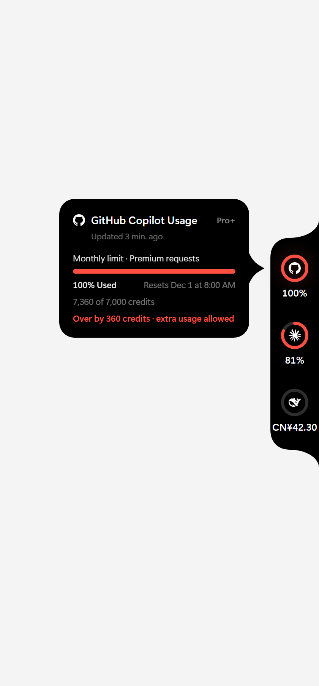

# Pulse for Windows（Pulse 的 Windows 版）

<p align="center"><b>简体中文</b> · <a href="README.md">English</a></p>

> **基于其他项目。** 本项目是 **[qunqin24](https://github.com/qunqin24) 的 [Pulse](https://github.com/qunqin24/Pulse)**（Apache-2.0，macOS 应用）的**非官方、独立 Windows 移植版**。我研究了原仓库的 UI/行为文档（`Docs/ui/*`、`Docs/providers/*`）、截图、服务商响应样例和服务商图标，再针对 Windows 重新实现。原项目是 Swift/SwiftUI，无法在 Windows 上运行，所以这里的代码是全新的 Electron + React + TypeScript 实现，不是原项目源码的编译产物。设计、交互细节和各服务商的读取规则归原作者所有，本项目与原作者没有关联。如果你喜欢它，也请去给[原版 Pulse](https://github.com/qunqin24/Pulse) 点个星。原项目的灵感来自 [Vinz (@hivinz_)](https://x.com/hivinz_/status/2092996055248126353) 分享的一个 UI 概念。

> **制作方式。** 整个项目——代码、测试和文档——都是用 **[Claude Code](https://claude.com/claude-code)** 配合 **Claude Sonnet 5.5** 模型完成的，由 [@su600](https://github.com/su600) 指导。请据此看待它：单元测试全部通过，但并非所有行为都已在真实账号和真实硬件上验证过（见下文“验证状态”）。

> 并非任何服务商的官方集成。所用的用量接口不是公开 API，可能随时变化。

Pulse 是一个本地优先的 AI 编程额度监视小工具：屏幕边缘贴着一条细长的黑色竖条，每个服务一个圆环，鼠标移到环上，会弹出一张卡片，列出每条额度和它的重置时间。没有 Pulse 账号，也没有 Pulse 服务器。

<p align="center"></p>

## 已实现的功能

| 方面 | 状态 |
|---|---|
| **GitHub Copilot** | 设备码登录（只申请 `read:user` 权限）；每月三类额度（高级请求 / 聊天 / 代码补全）；套餐名；超额与未开通额度的处理规则 |
| **Claude Code** | 读取 Claude Code 已保存的 OAuth 登录（`.claude\.credentials.json`）；5 小时 / 每周 / 按模型的额度窗口；套餐名 |
| **Codex** | 读取 `.codex\auth.json`；主/次窗口及按模型额度；套餐；积分余额 |
| **DeepSeek** | 用你粘贴的 API 密钥读取预付余额（用 Windows DPAPI 加密保存） |
| 浮动竖条 | 可停靠左/右或自由摆放；贴边吸附；自动收成细条；悬停弹卡；点击环刷新；拖动；右键菜单；黑色/浅色面板；三种大小与间距；连续/分段进度条；可选“距重置时间”弧；已用/剩余切换；可调变红阈值 |
| 数据刷新 | 只用一个定时器等最近到期的账号（不固定高频轮询）；每个账号同一时间只有一个读取任务；被取代的旧结果会被丢弃；保留最近一次成功数据并标记“已过期”；已重置的窗口不再显示；被限流后自动放慢；唤醒/解锁后刷新 |
| 通知 | 预警线、额度用尽、额度恢复、连续读取失败；按事件去重并跨重启保留；默认**全部关闭** |
| 设置 | 带搜索的侧栏；首次启动选择服务（选定前不读取任何内容）；每个账号一页，含连接诊断；英文和简体中文 |
| 隐私 | 密钥只保存在 `safeStorage`（DPAPI），绝不写入设置、日志或诊断；没选的服务绝不读取 |

**尚未移植：** 其余约 70 个服务商、Token 消耗/回顾、扩展、`--json` 命令行输出、服务状态页、动画机器人标记、液态玻璃/刘海停靠、全屏时隐藏。新增服务商的入口是适配器接口（`src/main/providers/types.ts`）。

## 运行

> **不要把本文件夹放在 `桌面（Desktop）` 下。** 在开发用电脑上，`electron.exe` 只要位于 `C:\Users\<你>\Desktop` 下的任何位置就会启动即崩溃（退出码 `0x80000003` / `0xC0000005`，没有任何日志）；放在 `C:\`、用户目录根或 `AppData` 下则一切正常。这是用同一个程序分别复制到各处测出来的；桌面一侧具体是什么原因没有查明。请把项目放在例如 `C:\Users\<你>\pulse-windows`，再用桌面**快捷方式**启动（运行一次 `scripts\make-desktop-shortcut.ps1`，快捷方式指向 `start-pulse.vbs`）。

**无命令行窗口启动：** 快捷方式运行的 `start-pulse.vbs` 直接启动 Electron，只有在 `out\` 缺失或 `src\` 比构建结果新时才在后台静默重新构建；失败时会弹出提示框并写入 `start-error.txt`。`start-pulse-debug.cmd` 功能相同但带可见的控制台，并会打印启动日志（`%APPDATA%\Pulse\pulse.log`）——界面没出来时用它排查。

```bash
npm install
npm run dev          # 启动 Electron（热更新）
npm run dev:web      # 在普通浏览器里用模拟后端预览面板/设置（?mock=demo|real|setup）
npm test             # 53 个单元测试
npm run dist         # 在 dist/ 生成 NSIS 安装包和便携版 exe（约 90–100 MB，未签名）
```

`PULSE_DEMO=1` 会用 6 个模拟的环启动程序（独立配置，不联网），适合截图。

**打包成 exe：** 运行 `npm run dist`，在 `dist\` 下得到：`Pulse Setup 0.1.0.exe`（安装程序，可选安装目录，安装到用户目录、不需要管理员权限）和 `Pulse 0.1.0.exe`（便携版，免安装，双击即用）。两者都**没有代码签名**，第一次运行 Windows SmartScreen 可能提示“未知发布者”，点“更多信息 → 仍要运行”即可。同样请不要把它们放在桌面下运行（见上）。

**首次启动**会打开选择窗口：勾选要监控的服务，再点“完成”。Copilot 的用法：打开它的设置页，点“登录…”，验证码会复制到剪贴板，浏览器会打开 GitHub，把验证码粘贴到页面里并点 Authorize。（GitHub 出于安全考虑从不预填验证码。）

## 目录结构

```
src/shared     领域模型、颜色/主额度/过期规则、预警规则、几何计算、多语言、设置校验（纯逻辑，有单元测试）
src/main       Electron 主进程：面板窗口控制、托盘、刷新协调器、存储（设置/密钥/缓存）、各服务商适配器
src/preload    唯一的类型化桥接（window.pulse）
src/renderer   panel/（竖条、环、卡片）和 settings/（外壳、各页面、首次选择）
tests          服务商解析（样例）、协调器、规则、预警、布局、设置、设备码登录
```

从原版 Pulse 沿用并由测试保证的设计规则：卡片打开时窗口不会改变大小；没有读数就画空环，绝不画成 0%；环的颜色表示离额度上限有多近，而不是品牌色；“已耗尽”以服务商的说法为准，不是单凭“100%”；已过重置时间的窗口绝不当作当前额度显示。

## 验证状态

单元测试、类型检查和生产构建均通过，渲染界面也在浏览器里对照 Pulse 的截图做过视觉检查。Codex 已在开发电脑上用真实登录实际读取过。真实的 Electron 应用也运行过（放在 `Desktop` 之外，见上）：它能正常启动、创建托盘图标，首次启动会打开设置/选择窗口；演示模式下，透明置顶的面板能正常渲染，悬停卡片能弹出（见 `docs/screenshots/real-window-hover.png`）。

**仍未验证，因为需要真人用鼠标操作：** 拖动与贴边吸附、透明区域的点击穿透、右键菜单、真实的系统通知，以及真实的 Copilot 登录。请你试一试，发现问题欢迎反馈。

**已知缺口：** Claude Code 的用量读取需要 `.claude\.credentials.json` 里有 `claudeAiOauth`。如果你的 Claude Code 把登录保存在别处，Pulse 会提示“没有找到已保存的登录”，而不是显示 0。macOS 版的状态栏钩子和桌面端会话两条读取路线没有移植。

## 许可

Apache-2.0，见 `LICENSE`。本项目派生自 qunqin24 的 Pulse（Apache-2.0）：服务商图标来自 [Lobe Icons](https://github.com/lobehub/lobe-icons)（见 `THIRD_PARTY_NOTICES.md`），Pulse 标志属于原项目。Apache 许可不授予任何厂商名称或标志的商标权。
